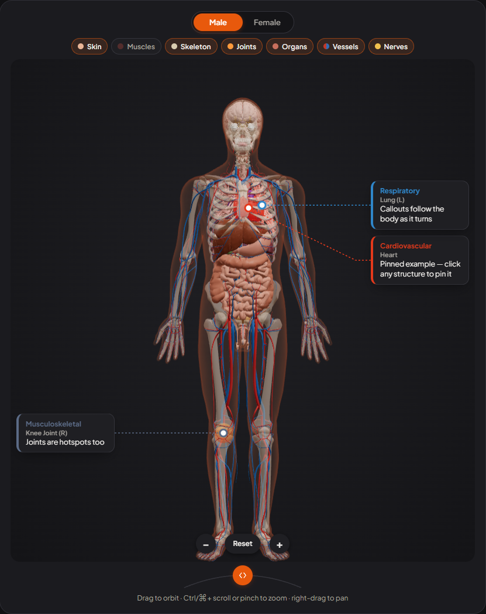

# Open Anatomy 3D

Free, interactive 3D human anatomy for the web. A male and a female body:
skin, skeleton, muscles, organs, vessels and nerves, each structure a separate
named mesh, plus a typed catalog of all of them and a ready-made React viewer.

**[Live demo](https://mervinr07.github.io/open-anatomy-3d/)** ·
[npm: open-anatomy-3d](https://www.npmjs.com/package/open-anatomy-3d) ·
[npm: open-anatomy-3d-react](https://www.npmjs.com/package/open-anatomy-3d-react)

<p align="center"></p>

| Package | What it is |
| --- | --- |
| [`open-anatomy-3d`](packages/open-anatomy-3d) | The two `.glb` models (≈7.6 MB and 8.1 MB) and the catalog of 147 structures with TypeScript types. Works with any engine: Three.js, Babylon.js, PlayCanvas, Unity, Godot, Blender… |
| [`open-anatomy-3d-react`](packages/open-anatomy-3d-react) | `<AnatomyViewer>`: orbit, zoom, body-system layers, hover labels, click-to-select and callout cards, built on react-three-fiber. |

## What's in the models

- **Two bodies** in the same relaxed anatomical pose, in metres, Y-up, feet on `y = 0`.
- **7 systems:** skin, skeleton, muscles, organs, vessels, nerves, plus 12 joint
  hotspots (shoulder, elbow, wrist, hip, knee, ankle — left and right).
- **147 structures** (140 in the male body, 145 in the female), e.g. `heart`,
  `lung_l`, `femur_r`, `kidney_l`, `spine_lumbar`, `uterus`. Each mesh is a
  glTF node whose name is its catalog key, grouped under one node per system.
- **Web-ready:** ~1M triangles per body, quantized and compressed with
  `EXT_meshopt_compression`.

## React quick start

```bash
npm i open-anatomy-3d open-anatomy-3d-react three @react-three/fiber @react-three/drei
```

```tsx
import { AnatomyViewer } from 'open-anatomy-3d-react'
import 'open-anatomy-3d-react/styles.css'

export function BodyMap() {
  return (
    <AnatomyViewer
      defaultSex="female"
      pins={[
        { key: 'heart', items: ['Hypertension'] },
        { key: 'knee_l', title: 'Mobility', items: ['Osteoarthritis'] },
      ]}
      onStructureClick={(key, structure) => console.log(key, structure.label)}
    />
  )
}
```

Tested with React 18 + `@react-three/fiber` 8 + `@react-three/drei` 9. The
component is client-only (it ships with `'use client'` for Next.js).

### `<AnatomyViewer>` props

| Prop | Type | Default | |
| --- | --- | --- | --- |
| `sex` / `defaultSex` / `onSexChange` | `'male' \| 'female'` | `'male'` | Controlled or uncontrolled body. |
| `layers` / `defaultLayers` / `onLayersChange` | `Record<AnatomySystem, boolean>` | all on except muscles | Visible systems. |
| `pins` | `{ key, title?, items?, color? }[]` | `[]` | Structures that glow and get a callout card. |
| `highlightedKeys` | `string[]` | `[]` | Extra structures that glow, without a card. |
| `onStructureClick` | `(key, structure) => void` | | Click on a structure or its card. |
| `onStructureHover` | `(key \| null) => void` | | |
| `hoverHint` | `string \| null` | `'Click to select'` | Second line of the hover label. |
| `modelUrls` | `{ male?, female? }` | jsDelivr CDN | Load self-hosted copies. |
| `showSexToggle`, `showLayerToggles`, `showZoomControls`, `showRotateControl` | `boolean` | `true` | Hide built-in controls. |
| `hoverColor`, `highlightColor` | CSS colour | orange / red | |
| `className`, `style`, `children` | | | `children` render over the canvas. |

**Controls:** drag to orbit, right-drag to pan, Ctrl/⌘ + wheel or pinch to
zoom (a plain wheel keeps scrolling the page), or use the buttons.

**Theming:** override the `--oa3d-*` CSS variables on your own class:

```css
.my-viewer.oa3d-viewer {
  --oa3d-accent: #0d9488;
  --oa3d-accent-deep: #0f766e;
  --oa3d-radius: 8px;
}
```

Dark mode follows `prefers-color-scheme`; set `data-theme="dark"` or
`"light"` on an ancestor to force one.

**Your own scene:** `<AnatomyModel>` is the body alone, for use inside your
own `<Canvas>` (wrap it in `<Suspense>`). `preloadAnatomy('female')` starts a
download early.

## Plain Three.js (or any engine)

```bash
npm i open-anatomy-3d three
```

```js
import * as THREE from 'three'
import { GLTFLoader } from 'three/addons/loaders/GLTFLoader.js'
import { MeshoptDecoder } from 'three/addons/libs/meshopt_decoder.module.js'
import { ANATOMY_BY_KEY, modelUrl } from 'open-anatomy-3d'

const loader = new GLTFLoader().setMeshoptDecoder(MeshoptDecoder) // required
const gltf = await loader.loadAsync(modelUrl('male'))
scene.add(gltf.scene)

gltf.scene.getObjectByName('muscles').visible = false // a whole system
const heart = gltf.scene.getObjectByName('heart')    // one structure
console.log(ANATOMY_BY_KEY.heart) // { key, label, system, category, color }
```

The files are in `node_modules/open-anatomy-3d/models/` and also on the CDN:

```
https://cdn.jsdelivr.net/npm/open-anatomy-3d@0.1.0/models/anatomy-male.glb
https://cdn.jsdelivr.net/npm/open-anatomy-3d@0.1.0/models/anatomy-female.glb
```

Engines without a meshopt decoder can use a decompressed copy:

```bash
npx @gltf-transform/cli copy anatomy-male.glb decoded.glb      # ≈19 MB, still KHR_mesh_quantization
npx @gltf-transform/cli dequantize decoded.glb plain.glb       # ≈31 MB, plain float32, no extensions
```

### Catalog API (`open-anatomy-3d`)

| Export | |
| --- | --- |
| `ANATOMY_STRUCTURES` | Every structure: `{ key, label, system, category, color, anchor?, anchorFemale?, sex? }`. |
| `ANATOMY_BY_KEY`, `getStructure(key)` | Lookup by key. |
| `structuresFor(sex)` | Structures present in one body. |
| `jointAnchor(structure, sex)` | A joint hotspot's centre (joints have no mesh). |
| `SYSTEMS`, `SYSTEM_LABELS`, `CATEGORIES`, `CATEGORY_COLORS` | Lists and display labels/colours. |
| `modelUrl(sex, base?)`, `MODEL_FILES` | Model locations. |
| `ATTRIBUTION` | The credit line to show (see below). |

The raw catalog is also importable as `open-anatomy-3d/catalog.json`.

## Licences and credit

- **Code** (both packages, the demo and the pipeline): [MIT](LICENSE).
- **Models**: [CC BY 4.0](LICENSE-MODELS.md). They are adapted from
  BodyParts3D (© DBCLS, CC BY 4.0), the Human Reference Atlas 3D reference
  organs (HuBMAP, CC BY 4.0) and MakeHuman (CC0). Full details:
  [ATTRIBUTION.md](ATTRIBUTION.md).

**If you show the models, you must credit them.** The simplest way is to
display the `ATTRIBUTION` string exported by the package, e.g. in your app's
about page or footer.

These models are for education and visualisation. They are not a medical
device and must not be used for diagnosis.

## Rebuilding the models

The [`pipeline/`](pipeline) folder rebuilds both models and the catalog from
the original datasets. See [pipeline/README.md](pipeline/README.md).

## Development

```bash
npm install
npm run dev        # build the packages, start the demo on http://localhost:5173
npm run verify     # check the catalog against the models
npm run typecheck
```

Contributions are welcome — see [CONTRIBUTING.md](CONTRIBUTING.md).
